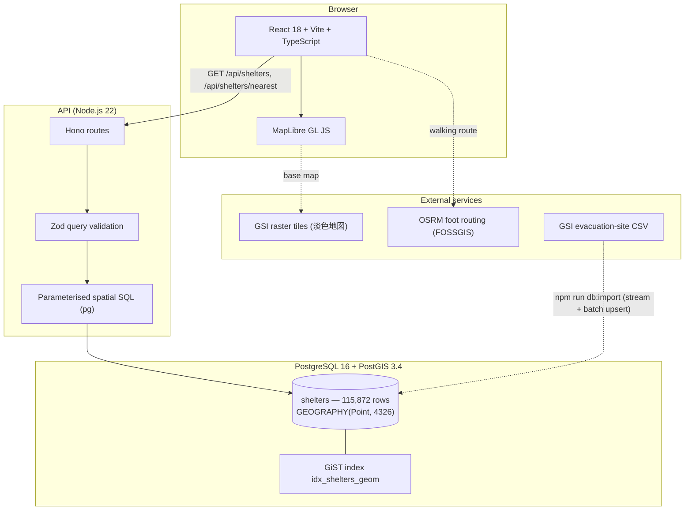

# Hinan Map（避難所マップ）

[](https://github.com/Bikash4JP/hinan-map/actions/workflows/ci.yml)

A bilingual (Japanese / English) web map that helps foreign residents and visitors in Japan find the nearest **designated emergency evacuation site** (指定緊急避難場所) for a given hazard.

**Live demo:** https://bikash4jp.com/projects/hinan-map/index.html

All 115,872 sites published by the Geospatial Information Authority of Japan (国土地理院, GSI) are stored in PostGIS. A small Hono API answers two spatial questions — *what is inside this map view?* and *what is nearest to this point?* — and a React + MapLibre GL JS front end draws the result on GSI map tiles.

> **日本語概要**
> 在日外国人・訪日旅行者が、災害の種類ごとに最寄りの「指定緊急避難場所」を探せる日英対応の WebGIS です。国土地理院が公開する全国 115,872 件のデータを PostGIS に取り込み、表示範囲検索（BBOX）と最近傍検索（k-NN）を Hono の API で提供し、React + MapLibre GL JS と地理院タイルで表示します。避難場所の名称は、現地の看板と照合できるよう日本語のまま表示します。ローカルでの起動手順は「[Getting started](#getting-started-local)」をご覧ください。

---

## Contents

- [Features](#features)
- [Architecture](#architecture)
- [Tech stack](#tech-stack)
- [Getting started (local)](#getting-started-local)
- [Configuration](#configuration)
- [API reference](#api-reference)
- [Data model and import](#data-model-and-import)
- [Design decisions](#design-decisions)
- [Measured performance](#measured-performance)
- [Testing and CI](#testing-and-ci)
- [Deployment](#deployment)
- [Known limitations and next steps](#known-limitations-and-next-steps)
- [Project structure](#project-structure)
- [Data sources and attribution](#data-sources-and-attribution)

---

## Features

| Feature | How it works |
|---|---|
| Map of evacuation sites | Loads only the sites inside the current map view (`bbox` query) each time the map stops moving. Points are clustered in the browser up to zoom 14. |
| Nearest sites | Click the map or press **現在地 / My location**. The API returns the 5 nearest sites with the geodesic distance in metres, and the map draws a walking route to the closest one. |
| Hazard filter | Eight hazard types from the GSI data: earthquake, flood, tsunami, landslide, large-scale fire, inland flooding, storm surge, volcano. A site is only shown if it is designated for the selected hazard. |
| Japanese / English UI | The UI text switches language. Site names and addresses stay in Japanese on purpose, so they match street signs and can be shown to someone when asking for directions. |
| Attribution | The GSI data, GSI tiles and OpenStreetMap credits are shown on the map. |

---

## Architecture



In development, Vite serves the front end on port 5173 and proxies `/api` to the API on port 3000. In Docker, Nginx serves the built front end on port 8080 and proxies `/api` to the API container.

---

## Tech stack

| Layer | Technology |
|---|---|
| Database | PostgreSQL 16 + PostGIS 3.4 (`postgis/postgis:16-3.4` image) |
| API | Node.js 22, TypeScript, Hono, Zod, `pg` (raw SQL, no ORM) |
| Front end | React 18, Vite 6, TypeScript, MapLibre GL JS 6 |
| Base map | GSI raster tiles, 淡色地図 (`cyberjapandata.gsi.go.jp/xyz/pale`) |
| Routing | OSRM foot profile hosted by FOSSGIS (`routing.openstreetmap.de`) |
| Tests / CI | Vitest, GitHub Actions with a PostGIS service container |
| Containers | Docker Compose: `db`, `api`, `web` (Nginx) |

---

## Getting started (local)

### Prerequisites

| Tool | Version | Check |
|---|---|---|
| Git | any recent | `git --version` |
| Node.js | 22.12 or newer (22 is used in CI and Docker) | `node --version` |
| Docker | Docker Desktop or Docker Engine with Compose v2 | `docker compose version` |

The default ports are **54320** (PostgreSQL), **3000** (API) and **5173** (front end). They must be free.

### 1. Clone the repository

```bash
git clone https://github.com/Bikash4JP/hinan-map.git
cd hinan-map
```

### 2. Start PostGIS

```bash
docker compose up -d db
```

This starts PostgreSQL + PostGIS on `localhost:54320` and creates the `shelters` table and its GiST index from [`db/init.sql`](db/init.sql). Wait until `docker compose ps` shows the `db` service as `healthy`.

The default credentials (`postgres` / `postgres`, database `hinan_map`) work without any configuration. To change them, copy `.env.example` to `.env` and edit it **before** this step.

### 3. Install dependencies

```bash
npm install
npm --prefix web install
```

The API and the front end have separate `package.json` files, so both commands are needed.

### 4. Import the evacuation-site data

```bash
npm run db:import
```

The script downloads the nationwide CSV from GSI and loads it into PostGIS. It takes well under a minute and ends with:

```text
Success! Total CSV rows processed: 115872, Total shelters in PostGIS: 115872
```

The import is an upsert keyed on the GSI common ID (共通ID), so it is safe to run again to refresh the data. The row count changes when GSI updates the dataset.

### 5. Run the API and the front end

Use two terminals:

```bash
# Terminal 1 — API on http://localhost:3000
npm run dev:api
```

```bash
# Terminal 2 — front end on http://localhost:5173
npm run dev:web
```

Open **http://localhost:5173**. The map starts at Nerima City Office in Tokyo. Click anywhere on the map to list the five nearest evacuation sites.

### 6. Check that it works

```bash
curl http://localhost:3000/api/health
# {"status":"ok", ... ,"database":"connected", ...}

curl "http://localhost:3000/api/shelters/nearest?lng=139.6517&lat=35.7356&limit=1"
# FeatureCollection whose first feature is 練馬区役所, a few metres away
```

### Alternative: run everything in Docker

```bash
docker compose up -d --build     # db + api + web (Nginx)
npm install                      # only needed for the import script
npm run db:import
```

Open **http://localhost:8080**. Stop the stack with `docker compose down` (add `-v` to delete the database volume as well).

### Troubleshooting

| Symptom | Cause and fix |
|---|---|
| `Port 3000 is already in use` | Another process (or the `api` container from the Docker alternative) holds the port. Stop it, for example with `docker compose stop api web`. |
| The map shows no points | The import has not been run, or the map is zoomed out below zoom 8 (a "zoom in" hint is shown). Run `npm run db:import` and zoom in. |
| `Database connection failed` from `/api/health` | The `db` container is not running or not yet healthy. Run `docker compose up -d db` and check `docker compose ps`. |
| **My location** does nothing | Browsers only allow geolocation on `localhost` or HTTPS, and only after you grant permission. |
| Port 54320 is taken | Set `POSTGRES_PORT` in `.env` before starting the database. The API and the import script read the same variable. |

---

## Configuration

All settings are environment variables, read from `.env` if the file exists. Every one has a working default for local development.

| Variable | Default | Used by | Purpose |
|---|---|---|---|
| `POSTGRES_HOST` | `localhost` | API, import | Database host |
| `POSTGRES_PORT` | `54320` | API, import, Compose | Database port (the host port that Compose publishes) |
| `POSTGRES_USER` | `postgres` | API, import, Compose | Database user |
| `POSTGRES_PASSWORD` | `postgres` | API, import, Compose | Database password |
| `POSTGRES_DB` | `hinan_map` | API, import, Compose | Database name |
| `PORT` | `3000` | API | HTTP port of the API. The Vite dev proxy expects 3000. |
| `PGSSLMODE` | unset | API, import | Set to `require` for a managed PostgreSQL that enforces TLS. Read by the `pg` driver. |
| `GSI_CSV_URL` | GSI nationwide CSV | import | Override the data source, for example with a local copy. |

---

## API reference

Base URL in development: `http://localhost:3000`. All responses are JSON. Successful shelter responses are GeoJSON `FeatureCollection`s with coordinates in `[longitude, latitude]` order (WGS 84).

### `GET /api/health`

Returns `200` with `{"status":"ok","database":"connected", ...}` when the database answers, otherwise `500`.

### `GET /api/shelters`

Sites inside a bounding box.

| Query parameter | Required | Description |
|---|---|---|
| `bbox` | yes | `minLng,minLat,maxLng,maxLat` in degrees. Must satisfy `min <= max` and stay within ±180 / ±90. |
| `hazard` | no | One of `earthquake`, `flood`, `tsunami`, `landslide`, `fire`, `inland_flood`, `storm_surge`, `volcano`. |
| `limit` | no | 1–3000, default 1000. |

```bash
curl "http://localhost:3000/api/shelters?bbox=139.60,35.70,139.70,35.78&hazard=flood&limit=2"
```

```json
{
  "type": "FeatureCollection",
  "attribution": "出典：国土地理院 指定緊急避難場所データ",
  "features": [
    {
      "type": "Feature",
      "geometry": { "type": "Point", "coordinates": [139.651645033, 35.735587448] },
      "properties": {
        "id": 33806,
        "name": "練馬区役所",
        "address": "東京都練馬区豊玉北6-12-1",
        "hazards": { "flood": true, "inland_flood": true, "tsunami": false, "earthquake": false }
      }
    }
  ]
}
```

(The `hazards` object is shortened here; it always contains all eight keys. `id` is a serial number and differs between imports.)

### `GET /api/shelters/nearest`

The nearest sites to a point, closest first.

| Query parameter | Required | Description |
|---|---|---|
| `lng` | yes | Longitude, −180 to 180. |
| `lat` | yes | Latitude, −90 to 90. |
| `hazard` | no | Same values as above. Sites not designated for the hazard are skipped. |
| `limit` | no | 1–50, default 5. |

Each feature has the same properties as above plus `distance_m`, the geodesic (straight-line) distance in metres, rounded to 0.1 m.

### Errors

Invalid parameters return `400` with the failing fields:

```json
{ "error": "Invalid query parameters", "details": { "bbox": ["bbox must be 'minLng,minLat,maxLng,maxLat' ..."] } }
```

Database failures return `500` with a generic message. The cause is logged on the server and not sent to the client.

---

## Data model and import

```sql
CREATE TABLE shelters (
  id        SERIAL PRIMARY KEY,
  kyotsu_id VARCHAR(50) UNIQUE,          -- GSI common ID (共通ID), the upsert key
  name      VARCHAR(255) NOT NULL,
  address   VARCHAR(500),
  hazards   JSONB NOT NULL DEFAULT '{}', -- {"flood": true, "tsunami": false, ...}
  geom      GEOGRAPHY(Point, 4326) NOT NULL
);
CREATE INDEX idx_shelters_geom ON shelters USING GIST (geom);
```

[`scripts/import-shelters.ts`](scripts/import-shelters.ts) pipes the HTTP download straight into a CSV parser (UTF-8 with BOM), so rows are processed as they arrive and memory use stays flat. Rows are written in batches of 1,000 with a single `INSERT ... SELECT FROM UNNEST(...) ON CONFLICT (kyotsu_id) DO UPDATE` statement per batch. Rows without valid coordinates are skipped.

| CSV column | Stored as |
|---|---|
| 共通ID | `kyotsu_id` |
| 施設・場所名 | `name` |
| 都道府県名及び市町村名 + 住所 | `address` |
| 緯度, 経度 | `geom` |
| 洪水 / 崖崩れ、土石流及び地滑り / 高潮 / 地震 / 津波 / 大規模な火事 / 内水氾濫 / 火山現象 | `hazards.flood` / `landslide` / `storm_surge` / `earthquake` / `tsunami` / `fire` / `inland_flood` / `volcano` |

**About the data.** A *designated emergency evacuation site* (指定緊急避難場所) is a place to escape immediate danger, and it is designated **per hazard type**: a site that is safe in a flood is not necessarily safe in a tsunami. That is why the hazard filter matters. It is a different thing from a *designated shelter* (指定避難所), where people stay after a disaster.

---

## Design decisions

### 1. PostGIS on the server instead of filtering in the browser

Sending all 115,872 points to the browser would mean a download of tens of megabytes before the map is usable, on a mobile network that may be congested during a disaster. With a GiST index the database returns just the rows a request needs, and "nearest site that accepts this hazard" is a single SQL statement.

### 2. Load by map view (bounding box)

Each time the map stops moving, the front end requests `GET /api/shelters?bbox=…` for the visible area and cancels any request still in flight with `AbortController`, so a slow older response cannot overwrite a newer one. A city-scale view returns a few hundred features (about 180 KB of GeoJSON uncompressed).

### 3. `GEOGRAPHY(Point, 4326)` instead of `GEOMETRY`

With `GEOMETRY` in EPSG:4326 the unit is degrees, and one degree of longitude is about 90 km in Tokyo but only about 78 km at the northern tip of Hokkaido, so "distance" would be wrong and inconsistent. `GEOGRAPHY` computes on the WGS 84 ellipsoid and returns metres, which is the number a person walking to a site needs. The nearest search orders by the KNN operator (`geom <-> point`), which walks the GiST index outward from the point; `ST_Distance` is then evaluated only for the rows returned. The trade-off is that `GEOGRAPHY` is slower and supports fewer functions than `GEOMETRY`, and it has a side effect on the bounding-box query described under [Known limitations](#known-limitations-and-next-steps).

---

## Measured performance

Measured with `EXPLAIN ANALYZE` (execution time, warm cache) against the full 115,872-row table, PostgreSQL 16.4 + PostGIS 3.4 in Docker Desktop on a Windows laptop. Treat these as an order of magnitude, not a benchmark.

| Query | Plan | Rows | Execution time |
|---|---|---|---|
| 5 nearest sites (`ORDER BY geom <-> point LIMIT 5`) | Index Scan using `idx_shelters_geom` | 5 | 7–9 ms |
| Bounding box, city scale (about 18 × 12 km around Nerima) | Bitmap Index Scan on `idx_shelters_geom` | 538 | 8–10 ms |
| Bounding box, regional scale (Kanto; 21,654 matches, capped by `LIMIT 2000`) | Parallel Bitmap Heap Scan | 2,000 | about 80 ms |

The table is 90 MB on disk, of which the GiST index is 15 MB. To reproduce:

```bash
docker exec hinan_map_db psql -U postgres -d hinan_map -c \
  "EXPLAIN ANALYZE SELECT id FROM shelters ORDER BY geom <-> ST_SetSRID(ST_MakePoint(139.6517, 35.7356), 4326)::geography LIMIT 5;"
```

---

## Testing and CI

```bash
npm test            # Vitest: 9 API tests against the PostGIS database
npm run typecheck   # tsc for the API, then tsc + production build of the front end
```

The tests need the database from step 2 to be running, but they do **not** need the GSI import. They insert three fixture sites in the open Pacific (over 900 km from the nearest real site), query only that area, and delete the fixtures afterwards, so the result is identical on an empty CI database and on a fully loaded local one. They cover the GeoJSON shape, the bounding-box boundary, the hazard filter, nearest-neighbour ordering, the distance unit (metres, not degrees) and input validation.

GitHub Actions ([`.github/workflows/ci.yml`](.github/workflows/ci.yml)) starts a `postgis/postgis:16-3.4` service container, applies `db/init.sql`, then runs the typecheck, the front-end build and the tests on every push and pull request to `main`.

---

## Deployment

**Docker Compose.** `docker compose up -d --build` runs the whole stack behind Nginx on port 8080, as described above.

**Static front end + serverless API.** The pieces are independent, so the app also runs without a permanently running server:

- **Front end.** `npm --prefix web run build` writes static files to `web/dist/`. Asset URLs are relative (`base: "./"`), so the same build works at a domain root or under a sub-path such as `/projects/hinan-map/`. The front end calls the API at `/api/...` on its own origin.
- **API.** `npm run build:lambda` bundles the API into a single file, `dist/lambda/index.js`, with an AWS Lambda handler (`index.handler`, from [`src/lambda.ts`](src/lambda.ts)). It works behind a Lambda Function URL or API Gateway HTTP API. Set the `POSTGRES_*` variables, and `PGSSLMODE=require` when the database enforces TLS.
- **Database.** Any PostgreSQL with the PostGIS extension. Apply `db/init.sql`, then run `npm run db:import` with the `POSTGRES_*` variables pointing at it.

Route `/api/*` on the site's origin to the API (for example with a CDN path rule) so the front end and the API share one origin.

The live demo runs this way: the static build on S3 behind CloudFront, a CloudFront `/api/*` behavior pointing at a Lambda Function URL, and PostGIS on Neon. No server runs when nobody is using it; the first request after an idle period takes a second or two while the database wakes up.

---

## Known limitations and next steps

- **Regional zoom shows a partial set.** Below zoom 8 nothing is loaded and a "zoom in" hint is shown. From zoom 8 the request is capped at 2,000 features with no ordering, so a view containing more (the Kanto region has about 21,600) shows an arbitrary subset and the cluster counts are too low. The planned fix is to serve vector tiles (`ST_AsMVT`, or a pre-built PMTiles archive, since the data changes rarely) instead of raw points.
- **Bounding box on `GEOGRAPHY`.** The box is built with `ST_MakeEnvelope(...)::geography`, so its edges are great-circle arcs, not lines of constant latitude. At city scale the difference is metres; at regional scale sites near the top and bottom edges can be included or missed. Filtering the box with `GEOMETRY` would match the screen rectangle exactly.
- **Distance versus route.** The distance shown in the list is the straight-line (geodesic) distance and is labelled as such. The blue line is a walking route, but its length and walking time are not displayed yet.
- **Third-party demo services.** Routing uses the public FOSSGIS OSRM server and map glyphs come from the MapLibre demo tile server. Both are fine for a demonstration, have no service guarantee, and would need to be self-hosted or replaced for real use. If routing fails, the app falls back to a straight line.
- **Front-end tests.** Only the API is tested.
- **Data freshness.** The data is a snapshot from the time of import. There is no scheduled refresh; run `npm run db:import` again to update.
- **Languages.** Japanese and English only. The dictionary in [`web/src/i18n.ts`](web/src/i18n.ts) is typed so that adding a language fails to compile until every key is translated.
- **CORS.** The API allows any origin. The data is public and read-only, but this should be narrowed if write endpoints are ever added.

This app is a learning project and not an official source of disaster information. In an emergency, follow the instructions of your municipality.

---

## Project structure

```text
.
├── db/init.sql                  # PostGIS extension, shelters table, GiST index
├── scripts/import-shelters.ts   # GSI CSV -> PostGIS (stream + batch upsert)
├── src/
│   ├── index.ts                 # Hono app: routes, validation, spatial SQL
│   ├── db.ts                    # pg connection pool
│   └── lambda.ts                # AWS Lambda entry point
├── tests/api.test.ts            # Vitest API tests (self-seeding fixtures)
├── web/
│   ├── src/App.tsx              # Map, clustering, nearest search, routing
│   ├── src/i18n.ts              # Japanese / English dictionary, hazard keys
│   ├── vite.config.ts           # Dev proxy for /api
│   ├── default.conf             # Nginx config for the Docker image
│   └── Dockerfile
├── Dockerfile.api
├── docker-compose.yml           # db, api, web
└── .github/workflows/ci.yml     # Typecheck, build, tests with a PostGIS service
```

---

## Data sources and attribution

- **Evacuation sites** — 出典：[国土地理院 指定緊急避難場所データ](https://www.gsi.go.jp/bousaichiri/hinanbasho.html)
- **Base map** — 出典：[国土地理院 地理院タイル（淡色地図）](https://maps.gsi.go.jp/development/ichiran.html)
- **Walking routes** — © [OpenStreetMap](https://www.openstreetmap.org/copyright) contributors, routed with [OSRM](https://project-osrm.org/) on the server operated by [FOSSGIS e.V.](https://routing.openstreetmap.de/about.html)
